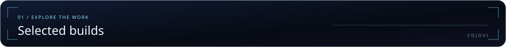
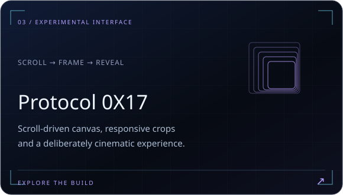
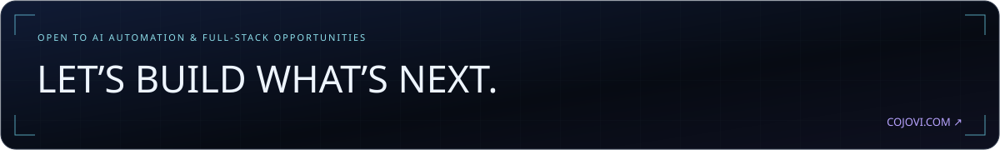

<picture>
  <source media="(prefers-reduced-motion: reduce) and (max-width: 640px)" srcset="assets/hero-mobile-still.svg">
  <source media="(prefers-reduced-motion: reduce)" srcset="assets/hero-still.svg">
  <source media="(max-width: 640px)" srcset="assets/hero-mobile.svg">
  
</picture>

**I'm Cody — I build AI automations, full-stack products, and interfaces with a point of view.**

I like working across the whole product: the idea, the interface, the data, and the workflow that makes it useful. My projects range from business operations software to personal tools and cinematic web experiences.

**Open to AI automation and full-stack engineering opportunities.** Based in Fort Worth, Texas.

[Explore my website ↗](https://cojovi.com) · [Browse my repositories ↗](https://github.com/cojovi?tab=repositories)

### CMAC Cinematic

A cinematic container-home showroom connected to an employee sales workspace. The build spans product presentation, inquiry capture, customer and lead workflows, and a separate inventory integration.

**Explore:** visual direction and React implementation · Supabase Auth and data policies · save-first inquiry handling · explicit CRM/inventory boundaries.

`React` · `TypeScript` · `Supabase` · `Vercel`

[Read the case study →](https://github.com/cojovi/cmac-cinematic#readme) · [Visit the showroom ↗](https://cmac-cinematic.vercel.app)

### More from the workshop

<table>
  <tr>
    <td width="50%"></td>
    <td width="50%"></td>
  </tr>
  <tr>
    <td><strong><a href="https://github.com/cojovi/operation_killswitch">Operation Killswitch</a></strong> Check-ins, deadlines, encrypted files, and scheduled release. An exploration of backend workflow and state.  <code>React</code> <code>TypeScript</code> <code>Supabase</code></td>
    <td><strong><a href="https://github.com/cojovi/Cojovi_Protocol_0X17">Protocol 0X17</a></strong> A cinematic frontend experiment with scroll-driven image sequences, canvas rendering, and responsive composition.  <code>Next.js</code> <code>React</code> <code>Canvas</code></td>
  </tr>
</table>

Also building for my own workflow: **[ReelVault](https://github.com/cojovi/cojo_social_media_dashboard)**, a local video archive and caption workbench with optional AI assistance.

<picture>
  <source media="(max-width: 640px)" srcset="assets/disciplines-mobile.svg">
  
</picture>

### How I work

I start with a problem I want to solve, build through the full workflow, and refine the details that make it understandable. I use AI tools throughout development; the product direction, integration decisions, and responsibility for the result are mine.

<a href="https://cojovi.com">cojovi.com</a> · <a href="https://github.com/cojovi?tab=repositories">More work</a> · <a href="design/README.md">About this profile's design</a>

